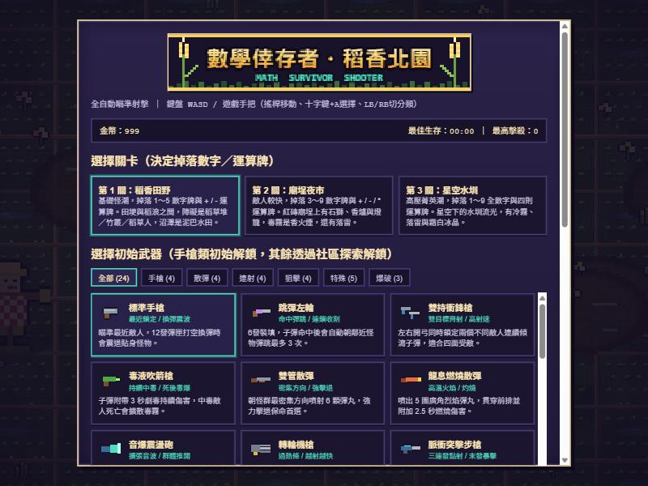
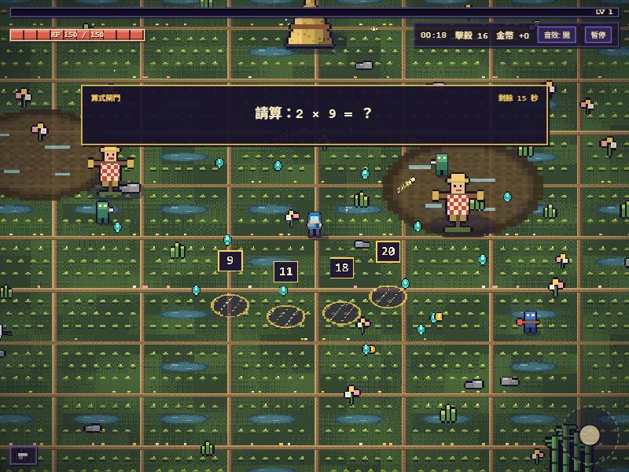
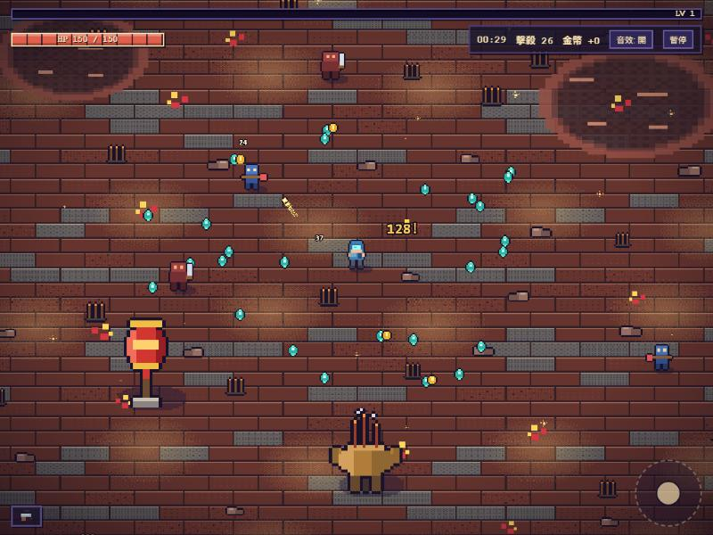
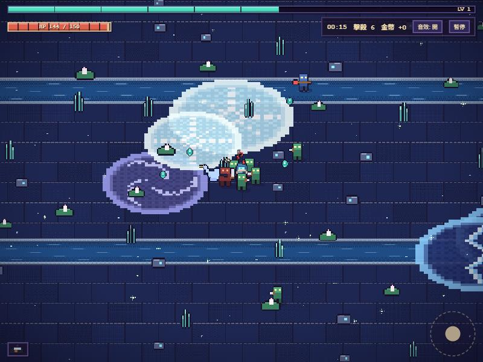
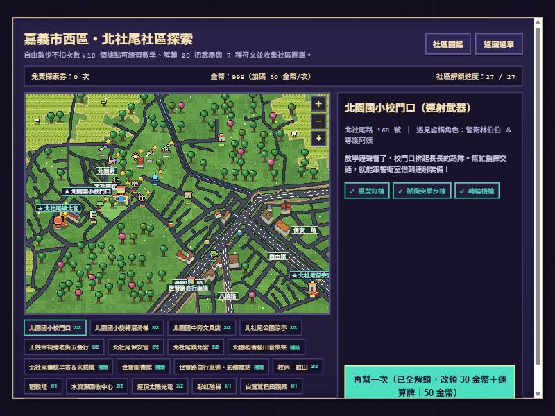
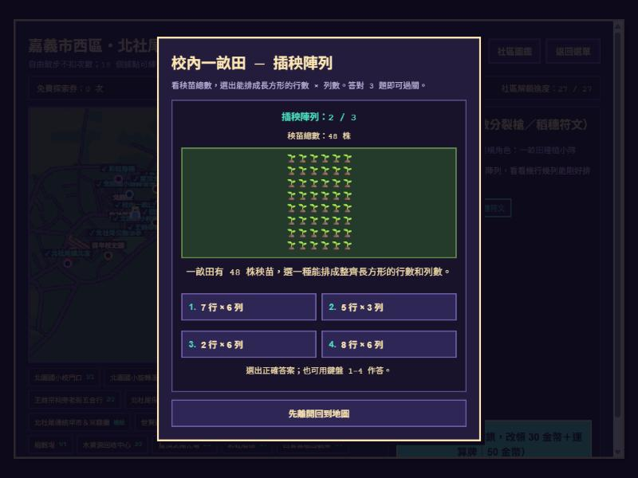

# 像素槍戰倖存者（Pixel Gun Survivors / Math Survivor Shooter）

純前端單機 2.5D 像素風自動射擊倖存者遊戲，結合**武器／符文／裝備構築**與**四則運算卡牌算式系統**。可直接開啟 `index.html` 遊玩，無需任何建置步驟。

---

## 遊戲畫面預覽

| 主選單：數學倖存者・稻香北園 | 第 1 關「稻香田野」＋算式閘門（走到正確答案踏板作答） |
| --- | --- |
|  |  |

| 第 2 關「廟埕夜市」（紅磚、香爐、燈籠） | 第 3 關「星空水圳」（水圳流光、冰晶） |
| --- | --- |
|  |  |

| 北社尾社區 2.5D 像素地圖（18 個據點） | 校內一畝田：插秧陣列小遊戲 |
| --- | --- |
|  |  |

舊版畫面（局外工坊、暫停面板等）

| 局外裝備／武器／符文算式工坊 | 遊戲暫停與即時數值面板 |
| --- | --- |
|  |  |

---

## 操作方式

- **鍵盤**：`W A S D` 或方向鍵移動；`1 / 2 / 3` 選擇升級項目；`ESC` 暫停／繼續。
- **滑鼠／觸控**：畫面右下角虛擬搖桿移動，點擊介面按鈕操作。
- **遊戲手把（Gamepad）**：左類比搖桿或十字鍵移動；`Start` / `Select` 暫停；選單中以十字鍵移動焦點、`A` 確認、`B` 返回或繼續。

---

## 關卡與動態局部環境

每場戰鬥會在玩家周圍維持 **6 個局部環境區域**，會在戰場上緩慢移動，且每 `12～21` 秒不定期更換位置與環境類型（非全地圖覆蓋）：

| 關卡 | 掉落卡牌 | 地形環境（1～3 種） |
| --- | --- | --- |
| 第 1 關：稻香田野 | 數字 `1～5`、運算 `+ / -` | **障礙物**（稻草堆／竹叢／稻草人，無法通過）、**沼澤**（泥巴水田，移動速度 ×0.55） |
| 第 2 關：廟埕夜市 | 數字 `3～9`、運算 `+ / - / *` | **障礙物**（石獅／香爐／紅燈籠柱）、**毒霧**（香火煙，每 0.5 秒持續扣血）、**打雷**（週期落雷傷害＋麻痺 0.85 秒） |
| 第 3 關：星空水圳 | 數字 `1～9`、運算 `+ / - / * / ÷` | **毒霧**（冷霧）、**打雷**、**冰雪**（霜白冰晶，攻擊速度 ×0.6） |

### 三關像素美術與打擊感

全部由程式繪製（Bayer 抖動＋色相偏移色階），不使用任何外部圖片或字型：

- **稻香田野**：田埂格線、成排稻株（兩幀微風搖擺）、田水窪反光、田邊小花；白鷺鷥飛過、花粉光點。
- **廟埕夜市**：紅磚錯縫地面與燈籠光暈（兩幀閃爍）、餘燼往上飄。
- **星空水圳**：深藍石板、橫貫水圳與流光（兩幀位移）、星點與螢火蟲。
- 每關 3 種站立精靈障礙物、地面小物（花草／小石／蘆葦等，不參與碰撞），並依主題替換沼澤、毒霧、打雷、冰雪貼圖。
- **打擊回饋**：傷害數字（爆擊放大變金色、擊倒橘色、玩家受傷紅色；主選單可關閉）、受擊閃白 0.06 秒、擊倒像素碎片與金幣閃光、槍口火花、依武器色的子彈拖尾、菁英怪金色光環與外框。
- 畫面邊緣暗角、像素風面板與按鈕按壓、血條／經驗條刻度與扣血殘影、主選單標題 LOGO（canvas 繪製）。
- 效能：所有動態物件都用固定上限的實例池（InstancedMesh）或 36 個重複使用的傷害數字精靈，戰鬥中不會每幀建立新的 Mesh、材質或貼圖。

---

## 怪物分類與異常狀態

| 分類 | 出現規則 | 怪物名稱 | 特性與異常狀態 |
| --- | --- | --- | --- |
| 近戰基礎怪 | 一般怪潮隨機出現 | 短劍兵 | 移動快、攻擊快、傷害低 |
| 近戰基礎怪 | 一般怪潮隨機出現 | 大刀兵 | 移動中等、攻擊中等、傷害中等 |
| 近戰基礎怪 | 一般怪潮隨機出現 | 長矛兵 | 移動快、攻擊快、傷害低，命中附加 **5 秒持續出血** |
| 中程怪 | 每累計生成 **200 隻**出現 1 隻 | 弓箭手 | 移動慢、攻擊慢、傷害高 |
| 中程怪 | 每累計生成 **200 隻**出現 1 隻 | 投石手 | 移動中等、攻擊中等、傷害低，命中造成 **暈眩 5 秒** |
| 遠程魔法師 | 每累計生成 **1000 隻**出現 1 隻 | 火 / 冰 / 雷魔法師 | 施法前先出現 **3～4.5 秒紅色落點預告圈**；火魔法（**燃燒 4 秒**）、冰魔法（**降低攻速 0.55 倍 5 秒**）、雷魔法（**麻痺 1.5 秒**） |
| 菁英怪 | 每 **40 秒**出現 1 隻 | 皇冠菁英怪 | 高生命與高掉落，近距離時會施放 **3.2 秒紅色範圍重擊預告** |

---

## 掉落機率一覽

- **吸血符文**：約 **`1 / 500`**（約每 500 隻怪掉落 1 次，須已解鎖）。
- **非吸血符文（火、雷、冰、光、震、水、稻穗、光電）**：進場時隨機決定本局期望間隔（**`50～200` 隻**之間，機率 `1/50 ～ 1/200`），且只會掉落已解鎖的符文；當場上所有武器皆鑲嵌滿 3 種符文時，改為自動轉換為金幣。
- **局外裝備**：約 **`1 / 200`**（約每 200 隻怪掉落 1 件）。
  - 品質等級權重：**基礎 60% ／ 中等 30% ／ 高級 10%**（不同等級具備不同初始基礎數值）。
- **數字／運算牌**：進場時隨機決定本局期望間隔（**`35～50` 隻**之間，機率 `1/35 ～ 1/50`）；多餘卡牌可在工坊開啟「販賣模式」以每張 `+5` 金幣賣出。

---

## 局外成長：裝備、武器、符文與算式工坊

### 1. 裝備部位（共 6 格）
- **武器 ×1**：攻擊、爆擊
- **盾牌 ×1**：生命、防禦、減傷
- **手套 ×2**：攻速、爆擊
- **鞋子 ×2**：跑速、減傷

### 2. 四則運算卡牌強化（裝備／武器／符文共用牌庫）
- 每個屬性槽位最多可放置 **5 張「數字牌 + 運算牌」**（先乘除後加減）。
- 不只裝備，**已解鎖武器**（例如跳彈左輪的裝填彈數與彈跳次數）與**已解鎖符文**皆可透過算式工坊強化核心數值。
- **減傷為負數增益**：減傷槽位算出的數值**越負代表減傷越多**（上限 `-75%`），讓 `-` 與 `÷` 運算牌在構築中同樣搶手！

### 3. 武器與符文解鎖
- **初始解鎖**：手槍類 4 把武器（標準手槍、跳彈左輪、雙持衝鋒槍、毒液吹箭槍）與「火」、「雷」2 種符文。
- 目前共有 **24 把武器**與 **9 種符文**；其餘 20 把武器與 7 種符文透過「嘉義市西區・北社尾社區」局外探索解鎖。

### 武器一覽

| 分類 | 武器 | 玩法重點 | 解鎖來源 |
| --- | --- | --- | --- |
| 手槍 | 標準手槍 | 最近鎖定；換彈時震退近身怪物 | 初始 |
| 手槍 | 跳彈左輪 | 命中後連續彈跳 | 初始 |
| 手槍 | 雙持衝鋒槍 | 左右同時攻擊兩個目標 | 初始 |
| 手槍 | 毒液吹箭槍 | 中毒持續傷害；死亡擴散毒霧 | 初始 |
| 散彈 | 雙管散彈 | 六顆廣角彈丸與強擊退 | 社區探索 |
| 散彈 | 龍息燃燒散彈 | 廣角火焰與燃燒 | 社區探索 |
| 散彈 | 音爆震盪砲 | 擴張音浪貫穿怪群 | 社區探索 |
| 散彈 | 水圳高壓水槍 | 短錐形水柱、強擊退與減速水窪 | 水資源回收中心 |
| 連射 | 轉輪機槍 | 連射升溫；過熱後停火降溫 | 社區探索 |
| 連射 | 脈衝突擊步槍 | 三連發；第三發必定暴擊 | 社區探索 |
| 連射 | 重型釘槍 | 高速貫穿並緩速 | 社區探索 |
| 連射 | 質數節拍步槍 | 以質數開火序號必定暴擊 | 彩虹階梯 |
| 狙擊 | 穿甲電磁狙擊 | 優先瞄準高血量目標並大量貫穿 | 社區探索 |
| 狙擊 | 冷凍射線槍 | 疊加寒氣並冰凍 | 社區探索 |
| 狙擊 | 重力奇點砲 | 聚集怪物後引爆 | 社區探索 |
| 狙擊 | 太陽光電雷射 | 靜止蓄三段能量；滿格長程貫穿 | 屋頂太陽光電 |
| 特殊 | 蜂群飛彈巢 | 多枚追蹤飛彈與範圍爆炸 | 社區探索 |
| 特殊 | 鋸齒迴旋刃槍 | 往返切割 | 社區探索 |
| 特殊 | 電漿連鎖槍 | 命中後連鎖電擊 | 社區探索 |
| 特殊 | 分數分裂槍 | 命中後依序分成 1/2、1/4 傷害子彈 | 校內一畝田 |
| 特殊 | 白鷺鷥追蹤弩 | 追蹤命中後折返玩家，再追擊兩次 | 白鷺鷥稻田觀察 |
| 爆破 | 電弧榴彈砲 | 拋物線範圍爆炸與緩速 | 社區探索 |
| 爆破 | 集束迫擊砲 | 主彈爆炸後分裂子炸彈 | 社區探索 |
| 爆破 | 廟會鞭炮連發器 | 落點主爆後再連環小爆炸 | 稻穀埕 |

### 符文一覽

| 符文 | 效果 | 解鎖來源 |
| --- | --- | --- |
| 火之符文 | 命中附加燃燒傷害 | 初始 |
| 雷之符文 | 命中後連鎖電擊 | 初始 |
| 冰之符文 | 緩速並有機會冰凍 | 社區探索 |
| 光之符文 | 致盲怪物並可附加傷害 | 社區探索 |
| 吸血符文 | 命中時機率回復生命 | 社區探索 |
| 震之符文 | 命中位置引發範圍震波 | 社區探索 |
| 水之符文 | 命中留下減速水窪；雷電可導電增傷 | 水資源回收中心 |
| 稻穗符文 | 擊倒怪物有機會掉落回血與經驗稻穀 | 校內一畝田 |
| 光電符文 | 命中累積能量；滿 100 釋放玩家周圍脈衝 | 屋頂太陽光電 |

### 符文共鳴

| 同武器符文 | 名稱 | 效果 |
| --- | --- | --- |
| 火＋雷 | 過載爆炸 | 同時命中時引爆小範圍震波 |
| 冰＋水 | 急凍水窪 | 水窪結冰；怪物踏入時滑退並短暫凍結 |
| 雷＋水 | 導電網 | 雷電沿水窪多跳一次並加強導電傷害 |
| 光＋光電 | 正午烈陽 | 光電脈衝範圍擴大並致盲怪物 |
| 稻穗＋吸血 | 豐收回春 | 提高稻穀掉落機率與回復量 |

---

## 局外探索：嘉義市西區・北社尾社區（2.5D 像素地圖）

以嘉義市西區北社尾聚落（北園國小周邊）的真實 OpenStreetMap 道路、水圳、綠地與建築輪廓為基底，透過 2.5D 像素逐層疊高渲染出可自由散步的社區地圖：

- **操作與互動**：
  - `W A S D` / 方向鍵或直接點擊地圖／據點按鈕自動走過去；空白鍵 / `E` / `Enter` 或點擊按鈕開始小遊戲。
  - 支援**滑鼠滾輪／右上角 `＋` `－` 放大縮小**（最高 `3.5` 倍）、**按住拖曳平移可視範圍**與**`⌖` 重置視野**；2.5D 建築具備實體碰撞，不可穿過。
- **探索次數規則（免費＋金幣雙軌制）**：
  - 初始贈送 **1 次免費探索券**，每完成 1 場局內戰鬥再送 **+1 次免費探索券**。
  - 在地圖上散步不扣次數；遊玩據點小遊戲時優先消耗 1 次免費探索券，用完後可花費 **50 金幣**加碼。
  - 若該據點的武器／符文已全部解鎖，再次通關可改領 **+30 金幣 ＋ 1 張隨機數字／運算牌**。

### 18 個探索據點與小遊戲一覽

以下人物與對話都是遊戲設計的虛構內容；圖鑑卡會標示「遊戲情境為虛構」。

| 社區據點 | 遊戲情境／NPC（虛構） | 社區小遊戲 | 解鎖／補給獎勵 |
| --- | --- | --- | --- |
| 北園國小校門口（警衛室） | 警衛林伯伯＆導護阿姨 | 放學路隊交通指揮 | **連射武器**：重型釘槍、脈衝突擊步槍、轉輪機槍 |
| 北園國小旋轉溜滑梯＆沙坑 | 自然科陳老師 | 自然課沙坑聚光鏡 | **狙擊武器**：冷凍射線槍、穿甲電磁狙擊、重力奇點砲 |
| 北園國中旁文具店 | 文具店阿美姐 | 文具店快速理貨 | **特殊武器**：鋸齒迴旋刃槍、電漿連鎖槍、蜂群飛彈巢 |
| 北社尾公園涼亭 | 早起運動的阿嬤 | 公園接嘉義椪柑 | **散彈武器**：雙管散彈、龍息燃燒散彈、音爆震盪砲 |
| 王姓宗祠旁老街五金行 | 五金行阿明師傅 | 五金行算找零 | **爆破武器**：電弧榴彈砲、集束迫擊砲 |
| 北社尾保安宮（自由路） | 保安宮廟公伯伯 | 廟埕擲筊祈福 | **符文**：光之符文、吸血符文 |
| 北社尾鎮北宮（城隍廟） | 陣頭鼓手大師兄 | 廟會大鼓節奏 | **符文**：冰之符文、震之符文 |
| 北園稻香藝田音樂祭 | 茶藝社小小司茶人＆管樂團 | 稻田音樂祭合奏 | **補給**：`+35` 金幣 ＋ 隨機運算牌 |
| 北社尾傳統早市＆米糕攤 | 早市米糕阿伯＆菜攤阿姨 | 早市買菜算找零 | **補給**：`+35` 金幣 ＋ 隨機局外裝備 |
| 世賢圖書館 | 圖書館志工姐姐 | 圖書館新書上架 | **補給**：`+35` 金幣 ＋ 隨機數字／運算牌 |
| 世賢路自行車道・彩繪驛站 | 北園校友單車學長 | 林蔭單車接補給 | **補給**：`+35` 金幣 ＋ 隨機數字牌 |
| 校內一畝田 | 種植小隊 | 插秧陣列：選出相符的行 × 列 | **武器／符文**：分數分裂槍、稻穗符文 |
| 稻穀埕 | 秤重小幫手 | 曬穀秤重：公斤、公克換算與加法 | **武器**：廟會鞭炮連發器 |
| 水資源回收中心 | 水循環學習夥伴 | 水循環排序、容量換算與倒水湊量 | **武器／符文**：水圳高壓水槍、水之符文 |
| 屋頂太陽光電 | 光電資料整理員 | 一週發電量長條圖判讀 | **武器／符文**：太陽光電雷射、光電符文 |
| 彩虹階梯 | 階梯規律觀察員 | 等差、倍數或質數數列 | **武器**：質數節拍步槍 |
| 白鷺鷥稻田觀察 | 田間觀察記錄員 | 短暫觀察鳥群後填統計表 | **武器**：白鷺鷥追蹤弩 |
| 百年校史牆 | 校史時間軸整理員 | 1922 年創校時間軸與週年計算 | **補給**：`+35` 金幣 ＋ 隨機運算牌 |

第一次通關每個據點會收集一張程式繪製的社區圖鑑卡。集滿 6 張可得 50 金幣，12 張可得隨機裝備，18 張可得 100 金幣與「北社尾探索達人」稱號；各階段獎勵只領一次。舊存檔會從空圖鑑開始，其他進度會保留。

探索數學題會依主選單年級段調整數字範圍。每題答錯可重試，第二次錯誤會顯示解法；答對才完成據點並領取解鎖或補給。新題型與找零題使用可重現的純函式產生，並由測試檢查答案。

## 戰鬥中的數學

- **算式閘門**：標準頻率約每 45～70 秒出一題。移動到地面答案踏板作答；答錯會收到提示，第二次仍錯或時間到才顯示答案與解說。答對可選回血、金幣或 20 秒攻速／移速增益。暫停作答時可按 `1–4`、點擊或用手把選答案。
- **稻穀豐收**：約每 90 秒啟動一次，限時 25 秒。擊倒怪物有機會掉落數字稻穀；依畫面規則撿滿 5 個符合的數字會放出稻浪；數字稻穀不會被磁鐵吸過來，要自己走過去挑，撿到不符合的會扣 1 點進度。
- **設定與紀錄**：主選單可設定年級段、題目頻率和作答時是否暫停；結算畫面列出本局題型表現與錯題解說，主選單「數學成長紀錄」會累計各題型作答次數。
- **除錯**：用網址 `?debug=1` 開啟遊戲（例如 `index.html?debug=1`），開始遊戲後可在瀏覽器主控台執行 `PGS.debug.forceQuizGate()` 或 `PGS.debug.forceHarvestTask()`，立即觸發對應玩法。

---

## 關卡頭目、數學連擊與弱項加強

- **關卡頭目**：每關第 5 分鐘出現頭目（第 1 關稻草人大王、第 2 關廟埕石獅王、第 3 關水圳巨龍），出現前 3 秒有警示。頭目有「算式護盾」：答對頭目算式閘門才能破盾 12 秒、造成傷害，約 2～3 次破盾可擊倒；頭目戰期間不再刷新小怪。擊倒後「關卡通關」，主選單關卡卡片顯示 ★，可選擇繼續無盡模式。
- **數學連擊**：連續「第一次就答對」累計連擊，答錯不扣分只歸零；連擊 3 攻擊 +10%、連擊 5 再 +10% 並掉落金幣袋（本局上限 +30%），局後顯示最高連擊。
- **弱項加強**：依存檔的作答紀錄，首答正確率較低或很久沒練到的題型較常出現（每種題型仍保有基本機率）；主選單「數學成長紀錄」提示「最近可以多練習」的題型。

## 社區探索分區

北園國小校內 7 個據點（校門口、彩虹階梯、屋頂太陽光電、旋轉溜滑梯、一畝田、稻穀埕、百年校史牆）收進「校園層」：社區地圖只顯示北園國小入口，走到入口按 Enter／點入口進入校園，按 Esc 或「← 離開校園」回社區。小遊戲、探索券、圖鑑規則不變。

---

## 發布更新注意事項

GitHub Pages 會讓瀏覽器快取檔案約 10 分鐘。`index.html` 裡每個本機程式檔與 `style.css` 都帶同一個版本參數（例如 `src/game.js?v=20261118c`），**每次推送新版都要把所有 `?v=` 改成新的同一個值**，玩家才不會拿到新舊檔混用的版本。`tests/optimization-regression.test.mjs` 會檢查版本參數是否一致、`src/` 下每個程式檔是否都有載入。

測試：`node --test tests/run-all.mjs`
