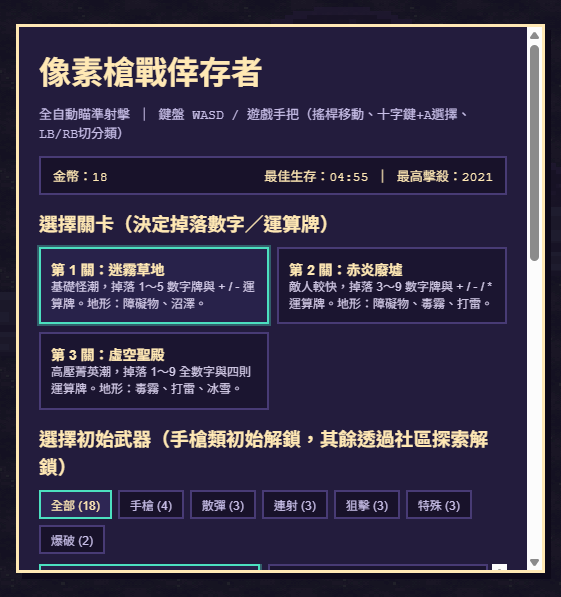
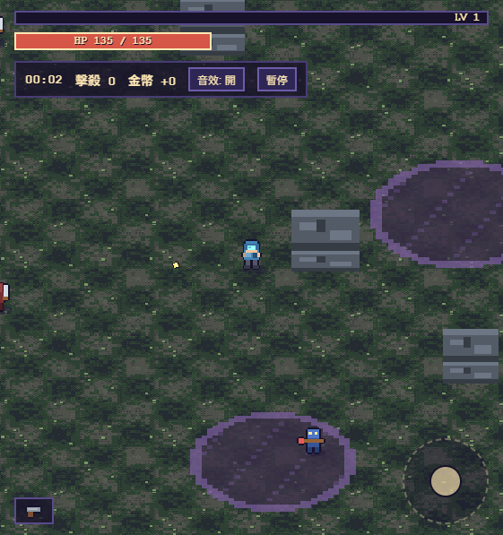
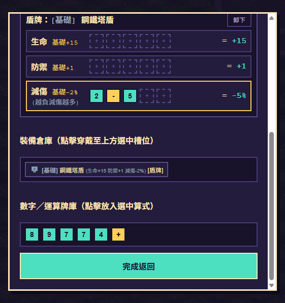
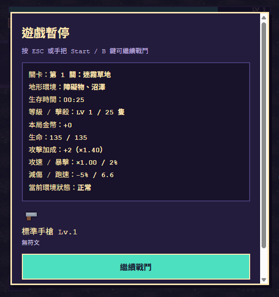

# 像素槍戰倖存者（Pixel Gun Survivors / Math Survivor Shooter）

純前端單機 2.5D 像素風自動射擊倖存者遊戲，結合**武器／符文／裝備構築**與**四則運算卡牌算式系統**。可直接開啟 `index.html` 遊玩，無需任何建置步驟。

---

## 遊戲畫面預覽

| 局外主選單與關卡選擇 | 戰鬥畫面（2.5D 怪物與動態局部地形） |
| --- | --- |
|  |  |

| 局外裝備／武器／符文算式工坊 | 遊戲暫停與即時數值面板 |
| --- | --- |
|  |  |

---

## 操作方式

- **鍵盤**：`W A S D` 或方向鍵移動；`1 / 2 / 3` 選擇升級項目；`ESC` 暫停／繼續。
- **滑鼠／觸控**：畫面右下角虛擬搖桿移動，點擊介面按鈕操作。
- **遊戲手把（Gamepad）**：左類比搖桿或十字鍵移動；`Start` / `Select` 暫停；選單中以十字鍵移動焦點、`A` 確認、`B` 返回或繼續。

---

## 關卡與動態局部環境

每場戰鬥會在玩家周圍維持 **6 個局部環境區域**，會在戰場上緩慢移動，且每 `12～21` 秒不定期更換位置與環境類型（非全地圖覆蓋）：

| 關卡 | 掉落卡牌 | 地形環境（1～3 種） |
| --- | --- | --- |
| 第 1 關：迷霧草地 | 數字 `1～5`、運算 `+ / -` | **障礙物**（無法通過）、**沼澤**（移動速度 ×0.55） |
| 第 2 關：赤炎廢墟 | 數字 `3～9`、運算 `+ / - / *` | **障礙物**、**毒霧**（每 0.5 秒持續扣血）、**打雷**（週期落雷傷害＋麻痺 0.85 秒） |
| 第 3 關：虛空聖殿 | 數字 `1～9`、運算 `+ / - / * / ÷` | **毒霧**、**打雷**、**冰雪**（攻擊速度 ×0.6） |

---

## 怪物分類與異常狀態

| 分類 | 出現規則 | 怪物名稱 | 特性與異常狀態 |
| --- | --- | --- | --- |
| 近戰基礎怪 | 一般怪潮隨機出現 | 短劍兵 | 移動快、攻擊快、傷害低 |
| 近戰基礎怪 | 一般怪潮隨機出現 | 大刀兵 | 移動中等、攻擊中等、傷害中等 |
| 近戰基礎怪 | 一般怪潮隨機出現 | 長矛兵 | 移動快、攻擊快、傷害低，命中附加 **5 秒持續出血** |
| 中程怪 | 每累計生成 **200 隻**出現 1 隻 | 弓箭手 | 移動慢、攻擊慢、傷害高 |
| 中程怪 | 每累計生成 **200 隻**出現 1 隻 | 投石手 | 移動中等、攻擊中等、傷害低，命中造成 **暈眩 5 秒** |
| 遠程魔法師 | 每累計生成 **1000 隻**出現 1 隻 | 火 / 冰 / 雷魔法師 | 施法前先出現 **3～4.5 秒紅色落點預告圈**；火魔法（**燃燒 4 秒**）、冰魔法（**降低攻速 0.55 倍 5 秒**）、雷魔法（**麻痺 1.5 秒**） |
| 菁英怪 | 每 **40 秒**出現 1 隻 | 皇冠菁英怪 | 高生命與高掉落，近距離時會施放 **3.2 秒紅色範圍重擊預告** |

---

## 掉落機率一覽

- **吸血符文**：約 **`1 / 500`**（約每 500 隻怪掉落 1 次，須已解鎖）。
- **其餘符文（火、雷、冰、光、震）**：進場時隨機決定本局期望間隔（**`50～200` 隻**之間，機率 `1/50 ～ 1/200`），且只會掉落已解鎖的符文；當場上所有武器皆鑲嵌滿 3 種符文時，改為自動轉換為金幣。
- **局外裝備**：約 **`1 / 200`**（約每 200 隻怪掉落 1 件）。
  - 品質等級權重：**基礎 60% ／ 中等 30% ／ 高級 10%**（不同等級具備不同初始基礎數值）。
- **數字／運算牌**：進場時隨機決定本局期望間隔（**`35～50` 隻**之間，機率 `1/35 ～ 1/50`）；多餘卡牌可在工坊開啟「販賣模式」以每張 `+5` 金幣賣出。

---

## 局外成長：裝備、武器、符文與算式工坊

### 1. 裝備部位（共 6 格）
- **武器 ×1**：攻擊、爆擊
- **盾牌 ×1**：生命、防禦、減傷
- **手套 ×2**：攻速、爆擊
- **鞋子 ×2**：跑速、減傷

### 2. 四則運算卡牌強化（裝備／武器／符文共用牌庫）
- 每個屬性槽位最多可放置 **5 張「數字牌 + 運算牌」**（先乘除後加減）。
- 不只裝備，**已解鎖武器**（例如跳彈左輪的裝填彈數與彈跳次數）與**已解鎖符文**皆可透過算式工坊強化核心數值。
- **減傷為負數增益**：減傷槽位算出的數值**越負代表減傷越多**（上限 `-75%`），讓 `-` 與 `÷` 運算牌在構築中同樣搶手！

### 3. 武器與符文解鎖
- **初始解鎖**：手槍類 4 把武器（標準手槍、跳彈左輪、雙持衝鋒槍、毒液吹箭槍）與「火」、「雷」2 種符文。
- 其餘武器與符文已預留解鎖接口，將於後續透過**「國小周邊社區事件」**探索解鎖。
